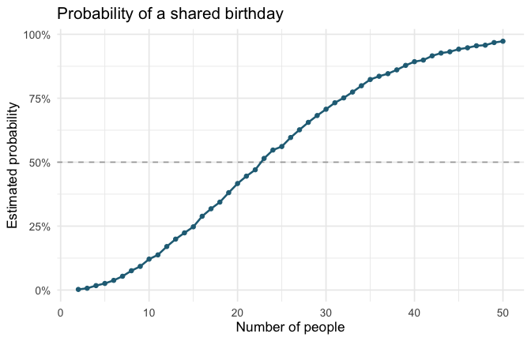
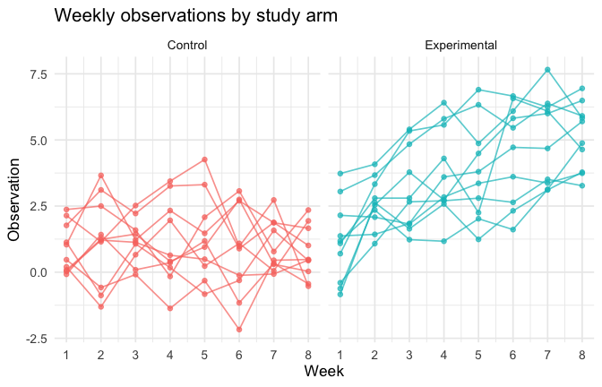
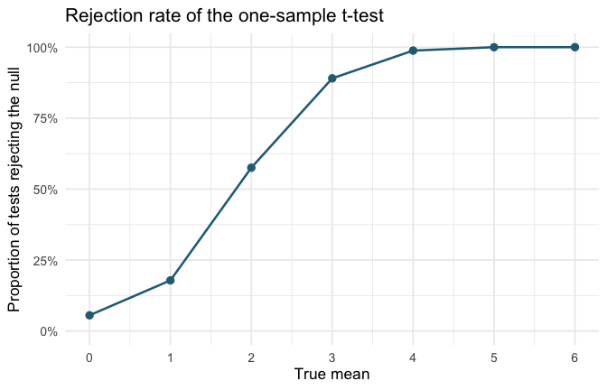
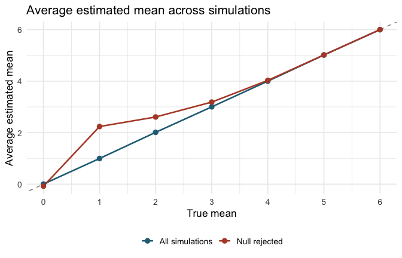

p8105_hw5_lc4152
================

``` r
library(tidyverse)
```

    ## ── Attaching core tidyverse packages ──────────────────────── tidyverse 2.0.0 ──
    ## ✔ dplyr     1.2.1     ✔ readr     2.2.0
    ## ✔ forcats   1.0.1     ✔ stringr   1.6.0
    ## ✔ ggplot2   4.0.3     ✔ tibble    3.3.1
    ## ✔ lubridate 1.9.5     ✔ tidyr     1.3.2
    ## ✔ purrr     1.2.2     
    ## ── Conflicts ────────────────────────────────────────── tidyverse_conflicts() ──
    ## ✖ dplyr::filter() masks stats::filter()
    ## ✖ dplyr::lag()    masks stats::lag()
    ## ℹ Use the conflicted package (<http://conflicted.r-lib.org/>) to force all conflicts to become errors

``` r
knitr::opts_chunk$set(
  fig.width = 7,
  fig.height = 4.5,
  out.width = "95%"
)

theme_set(theme_minimal(base_size = 13))
```

## Problem 1

``` r
set.seed(8105)

has_shared_birthday = function(group_size) {
  birthdays = sample.int(365, size = group_size, replace = TRUE)
  anyDuplicated(birthdays) > 0L
}

birthday_results =
  tibble(group_size = 2:50) |>
  mutate(
    probability = map_dbl(
      group_size,
      \(size) mean(replicate(10000, has_shared_birthday(size)))
    )
  )

birthday_results |>
  ggplot(aes(x = group_size, y = probability)) +
  geom_hline(yintercept = 0.5, linetype = "dashed", color = "gray65") +
  geom_line(linewidth = 0.9, color = "#256D85") +
  geom_point(size = 1.5, color = "#256D85") +
  scale_y_continuous(labels = scales::label_percent()) +
  labs(
    title = "Probability of a shared birthday",
    x = "Number of people",
    y = "Estimated probability"
  )
```


The estimated probability of at least two people sharing a birthday
increases with group size and reaches approximately 50% at 23 people.

## Problem 2

``` r
subject_files =
  tibble(
    file_path = list.files(path = "data", full.names = TRUE)
  ) |>
  mutate(
    file_name = basename(file_path),
    observations = purrr::map(
      file_path,
      \(path) read_csv(path, show_col_types = FALSE)
    )
  )

longitudinal_df =
  subject_files |>
  select(file_name, observations) |>
  mutate(file_name = str_remove(file_name, "\\.csv$")) |>
  separate_wider_delim(
    file_name,
    delim = "_",
    names = c("arm", "subject_id")
  ) |>
  mutate(
    arm = factor(
      arm,
      levels = c("con", "exp"),
      labels = c("Control", "Experimental")
    )
  ) |>
  unnest(observations) |>
  pivot_longer(
    cols = starts_with("week_"),
    names_to = "week",
    names_prefix = "week_",
    names_transform = list(week = as.integer),
    values_to = "observation"
  )

longitudinal_df
```

    ## # A tibble: 160 × 4
    ##    arm     subject_id  week observation
    ##    <fct>   <chr>      <int>       <dbl>
    ##  1 Control 01             1        0.2 
    ##  2 Control 01             2       -1.31
    ##  3 Control 01             3        0.66
    ##  4 Control 01             4        1.96
    ##  5 Control 01             5        0.23
    ##  6 Control 01             6        1.09
    ##  7 Control 01             7        0.05
    ##  8 Control 01             8        1.94
    ##  9 Control 02             1        1.13
    ## 10 Control 02             2       -0.88
    ## # ℹ 150 more rows

``` r
longitudinal_df |>
  ggplot(
    aes(
      x = week,
      y = observation,
      group = interaction(arm, subject_id),
      color = arm
    )
  ) +
  geom_line(alpha = 0.7) +
  geom_point(size = 1.5, alpha = 0.7) +
  facet_wrap(vars(arm)) +
  scale_x_continuous(breaks = 1:8) +
  labs(
    title = "Weekly observations by study arm",
    x = "Week",
    y = "Observation"
  ) +
  theme(legend.position = "none")
```


Observations generally increased over time in the experimental arm,
while those in the control arm fluctuated without a clear upward trend.
All 10 participants in the experimental arm had higher observations at
week 8 than at week 1.

## Problem 3

``` r
set.seed(8106)

sample_size = 30
population_sd = 5
alpha = 0.05
n_simulations = 5000

simulate_t_test = function(true_mean) {
  sample_values = rnorm(
    n = sample_size,
    mean = true_mean,
    sd = population_sd
  )

  t.test(sample_values, mu = 0, alternative = "two.sided") |>
    broom::tidy() |>
    select(estimate, p.value)
}

t_test_results =
  expand_grid(
    true_mean = 0:6,
    simulation = seq_len(n_simulations)
  ) |>
  mutate(result = map(true_mean, simulate_t_test)) |>
  unnest(result) |>
  mutate(rejected = p.value < alpha)

t_test_summary =
  t_test_results |>
  group_by(true_mean) |>
  summarize(
    rejection_rate = mean(rejected),
    all_estimates = mean(estimate),
    rejected_estimates = mean(estimate[rejected]),
    .groups = "drop"
  )

t_test_summary
```

    ## # A tibble: 7 × 4
    ##   true_mean rejection_rate all_estimates rejected_estimates
    ##       <int>          <dbl>         <dbl>              <dbl>
    ## 1         0         0.0554       0.00577            -0.0757
    ## 2         1         0.178        0.997               2.24  
    ## 3         2         0.575        2.01                2.61  
    ## 4         3         0.890        3.00                3.19  
    ## 5         4         0.988        4.00                4.03  
    ## 6         5         1            5.02                5.02  
    ## 7         6         1            6.00                6.00

``` r
t_test_summary |>
  ggplot(aes(x = true_mean, y = rejection_rate)) +
  geom_line(linewidth = 0.9, color = "#256D85") +
  geom_point(size = 2.5, color = "#256D85") +
  scale_x_continuous(breaks = 0:6) +
  scale_y_continuous(
    limits = c(0, 1),
    labels = scales::label_percent()
  ) +
  labs(
    title = "Rejection rate of the one-sample t-test",
    x = "True mean",
    y = "Proportion of tests rejecting the null"
  )
```


At a true mean of zero, the rejection rate is close to 5%, the nominal
Type I error rate. As the true mean increases from 1 to 6, the effect
size grows and the power approaches 100%.

``` r
t_test_summary |>
  select(true_mean, all_estimates, rejected_estimates) |>
  pivot_longer(
    cols = c(all_estimates, rejected_estimates),
    names_to = "sample_set",
    values_to = "average_estimate"
  ) |>
  mutate(
    sample_set = recode(
      sample_set,
      all_estimates = "All simulations",
      rejected_estimates = "Null rejected"
    )
  ) |>
  ggplot(
    aes(x = true_mean, y = average_estimate, color = sample_set)
  ) +
  geom_abline(
    slope = 1,
    intercept = 0,
    linetype = "dashed",
    color = "gray60"
  ) +
  geom_line(linewidth = 0.9) +
  geom_point(size = 2.5) +
  scale_x_continuous(breaks = 0:6) +
  scale_color_manual(
    values = c("All simulations" = "#256D85", "Null rejected" = "#B54A32")
  ) +
  labs(
    title = "Average estimated mean across simulations",
    x = "True mean",
    y = "Average estimated mean",
    color = NULL
  ) +
  theme(legend.position = "bottom")
```


Across all simulations, the average estimated mean closely followed the
true mean. When only simulations that rejected the null were included,
the average estimate was higher than the true mean for small positive
effects. For example, when the true mean was 1, the average estimate
among significant results was about 2.2. This occurs because unusually
large positive sample means are more likely to produce significant
results when the true effect is small. As power increased, nearly all
simulations rejected the null, and the two averages converged.
